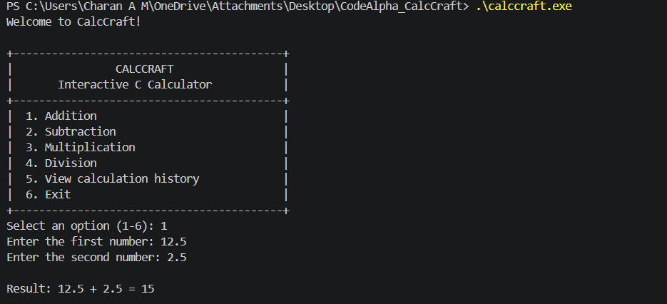
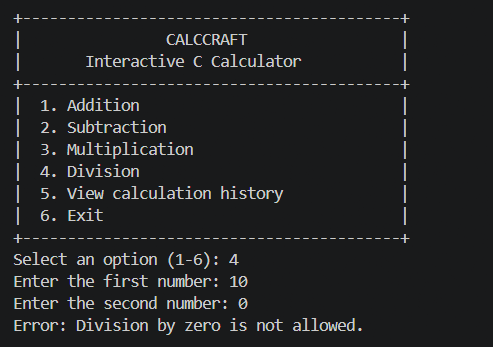
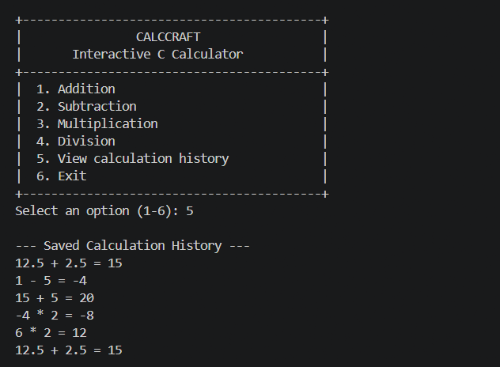

# CalcCraft – Interactive C Calculator


## About the Project

CalcCraft is an interactive command-line calculator developed using C programming as part of the CodeAlpha C Programming Internship.

It provides arithmetic operations, input validation, error handling and persistent calculation history.

## Features

- Addition
- Subtraction
- Multiplication
- Division
- Interactive menu-driven interface
- Input validation
- Division-by-zero protection
- Calculation history
- Persistent storage using file handling

## Technologies Used

- C Programming
- GCC Compiler
- C Standard Library
- File Handling
- Git and GitHub

## How to Compile

Install GCC and run:

```bash
gcc -std=c11 -Wall -Wextra -Wpedantic -O2 main.c -o calccraft.exe
```

## How to Run

On Windows PowerShell:

```powershell
.\calccraft.exe
```

## Project Structure

```text
CodeAlpha_CalcCraft/
├── main.c
├── README.md
├── .gitignore
└── calccraft_history.txt  (generated automatically)
```

## Concepts Demonstrated

- Functions
- Loops
- Switch-case statements
- Input validation
- File handling
- Error handling

## Internship Information

**Organization:** CodeAlpha  
**Domain:** C Programming  
**Batch:** 10 October – 10 November 2026

## Author

Charan A M

## Screenshots

### Main Menu and Calculation


### Error Handling


### Calculation History

