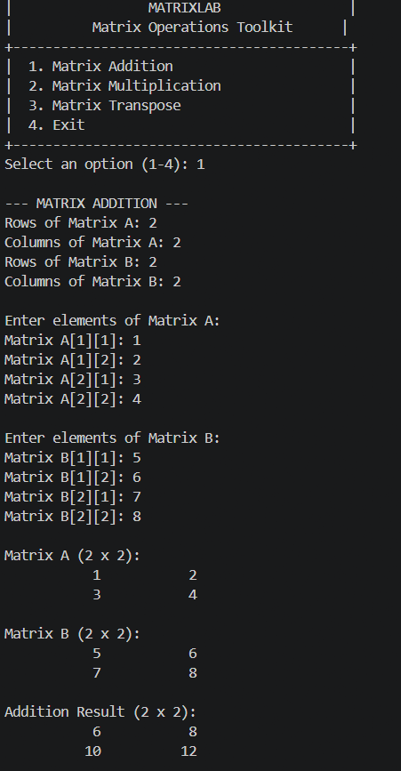
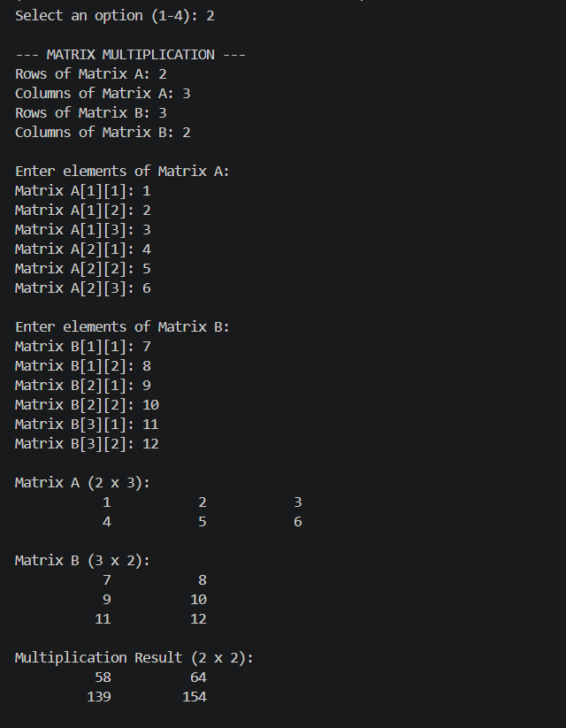
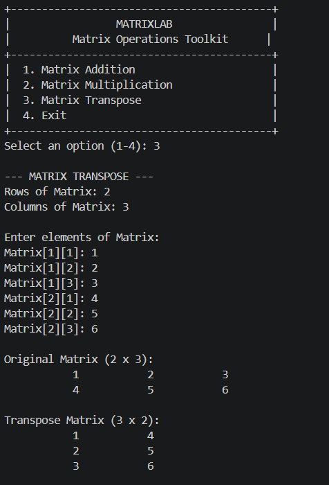

# MatrixLab – Matrix Operations Toolkit


## About the Project

MatrixLab is a menu-driven matrix operations application developed using C programming as part of the CodeAlpha C Programming Internship.

It performs matrix addition, multiplication and transpose using functions and two-dimensional arrays.

## Features

- Matrix Addition
- Matrix Multiplication
- Matrix Transpose
- Support for rectangular matrices
- Interactive menu-driven interface
- Matrix dimension validation
- Input validation
- Formatted matrix output
- Supports matrices up to 10 × 10

## Technologies Used

- C Programming
- GCC Compiler
- Two-Dimensional Arrays
- Functions
- Git and GitHub

## How to Compile

```bash
gcc -std=c11 -Wall -Wextra -Wpedantic -O2 main.c -o matrixlab.exe
```

## How to Run

On Windows PowerShell:

```powershell
.\matrixlab.exe
```

## Mathematical Operations

### Addition

Two matrices must have identical dimensions.

### Multiplication

The number of columns in Matrix A must equal the number of rows in Matrix B.

### Transpose

Rows become columns and columns become rows.

## Screenshots

### Matrix Addition


### Matrix Multiplication


### Matrix Transpose


## Concepts Demonstrated

- Functions
- 2D arrays
- Nested loops
- Switch-case statements
- Input validation
- Matrix mathematics
- Modular programming

## Testing

All three primary matrix operations have been tested using sample matrices, including rectangular matrix multiplication and transpose.

## Internship Information

**Organization:** CodeAlpha  
**Domain:** C Programming  
**Batch:** October–November 2026

## Author

Charan A M
