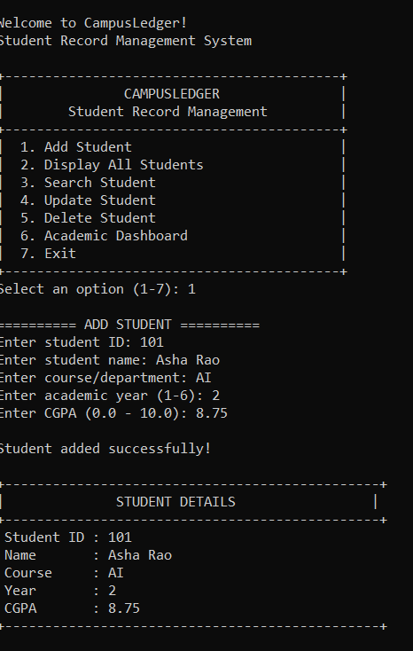
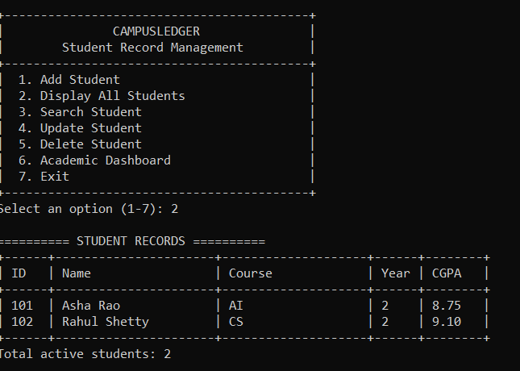
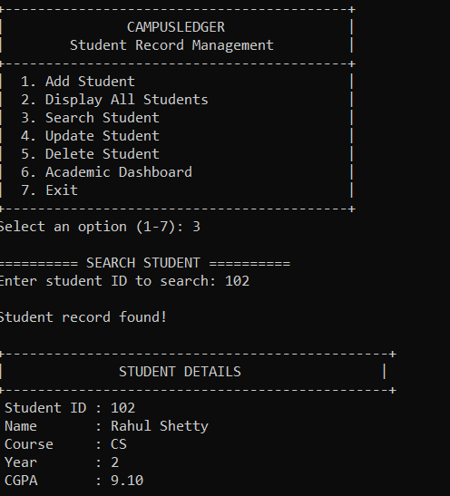
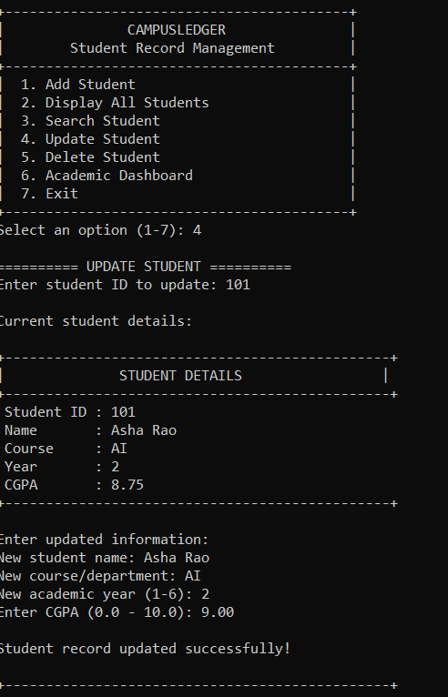
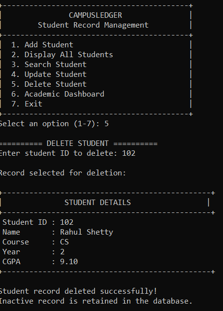
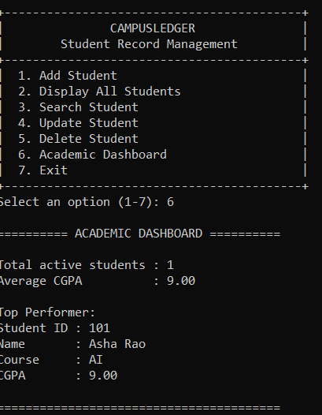
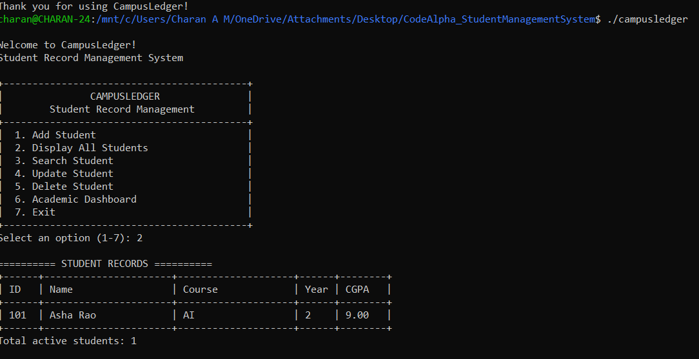

# CampusLedger - Student Record Management System


## About

CampusLedger is a menu-driven Student Record Management System developed using C programming as part of the CodeAlpha C Programming Internship.

It manages student records using structures and binary file handling.

## Features

- Add student records
- Display all active students
- Search students by ID
- Update student information
- Delete student records using logical deletion
- Academic dashboard
- Average CGPA calculation
- Top-performing student identification
- Input validation
- Persistent data storage

## Technologies

- C Programming
- GCC
- Structures
- Functions
- Binary File Handling
- Git and GitHub

## Compile

```bash
gcc -std=c11 -Wall -Wextra -Wpedantic -O2 main.c -o campusledger
```

## Run

```bash
./campusledger
```

## Database

The application automatically creates `students.dat`.

Student records remain saved after the application exits. Deleted records are marked inactive.

The database is excluded from this public repository.

## Project Structure

```text
CodeAlpha_StudentManagementSystem/
├── main.c
├── README.md
├── .gitignore
└── screenshots/
    ├── add-student.png
    ├── display-students.png
    ├── search-student.png
    ├── update-student.png
    ├── delete-student.png
    ├── academic-dashboard.png
    └── data-persistence.png
```

## Screenshots

### Add Student


### Display Students


### Search Student


### Update Student


### Delete Student


### Academic Dashboard


### Data Persistence


## Concepts Demonstrated

- Structures
- Functions
- Strings and arrays
- Switch-case
- Loops and conditionals
- File handling
- CRUD operations
- Logical deletion
- Input validation

## Testing

Tested adding, displaying, searching, updating and deleting student records, academic statistics and persistent storage after application restart.

## Internship

Organization: CodeAlpha  
Domain: C Programming  
Batch: October-November 2026

## Author

Charan A M